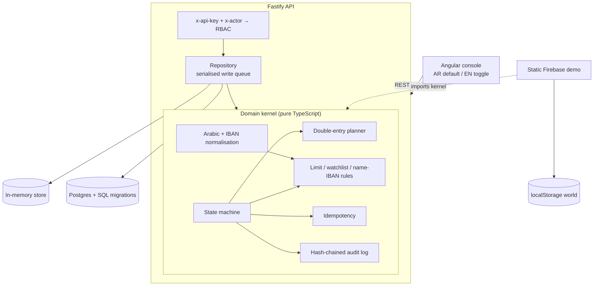

# Architecture

This document describes how the payments operations kernel works. The same
TypeScript modules run inside the Fastify API, inside unit tests, and inside
the static browser demo.

## Why a kernel

Settlement defects are not ordinary bugs: they move money and they leave an
evidence trail that auditors will read. The domain rules (what states exist,
when a checker is required, how a journal must balance, how an Arabic name is
compared to an IBAN directory) therefore live in `backend/src/domain` with
**no filesystem, no HTTP, no Postgres**. Persistence and transport are ports
around that kernel.



## Payment instruction lifecycle

```
initiated → validated → screened → submitted → settled → reversed
    \           \           \           \
     '------ failed <-------'------------'
```

| From | To | Who | What happens |
|---|---|---|---|
| initiated | validated | maker / admin | Schema, IBAN checksum, debtor ≠ creditor, positive amount |
| initiated | failed | maker / admin | Validation problems recorded on `failureReason` |
| validated | screened | maker / checker / admin | Rule engine writes `rule_hits`; approval may become `pending` |
| screened | submitted | maker / admin | Allowed only if no `block` hit and approval is `approved` or `not_required`. Posts the journal. |
| screened | failed | checker / admin | Four-eyes reject |
| submitted | settled | admin (simulates the rail) | Scheme acknowledgement |
| submitted | failed | admin | Scheme reject; the submission journal is inverted |
| settled | reversed | admin | Post-settlement return; the submission journal is inverted |

A maker cannot approve or reject their own instruction. Payments at or above
the currency threshold (EGP 50,000 in the demo) or with a `warn`/`block` hit
always require a checker.

Kinds, described generically (no scheme trademarks):

- `credit_transfer` — batch / next-cycle account-to-account
- `bill_payment` — credit to a registered biller
- `instant_credit` — seconds-to-settle account-to-account rail, with a small fee

## Double-entry ledger

Money is stored as **integer minor units** end to end (piasters / cents).
Amounts arrive as decimal strings and are parsed without floating point.

On `submit` the kernel plans a balanced journal:

```
Dr  liability:customer_deposits     amount + fee
    Cr  asset:{instant_scheme|clearing_network}     amount
    Cr  income:scheme_fees                          fee   (instant rail only)
```

A later `fail` (after submit) or `reverse` (after settle) posts the inverted
lines so account balances net to zero. `assertBalanced` refuses any journal
whose debits and credits do not match per currency.

Signed balances are debit − credit. A liability decrease therefore shows as a
positive debit balance on `liability:customer_deposits`.

## Idempotency

`POST /api/v1/payments` accepts an `Idempotency-Key` header. The pair
`(tenant, key)` maps to exactly one payment. Replaying the **same** payload
returns the original row with `replayed: true`. Reusing the key with a
different payload returns `409`. This is the same contract a scheme or a
mobile channel needs when its HTTP client retries.

## Arabic and IBAN matching

`backend/src/domain/arabic.ts` is deliberately boring and well tested:

- Arabic-Indic and Persian digits → Latin
- strip tashkeel and tatweel
- fold `أ إ آ ٱ` → `ا`, `ة` → `ه`, `ى` → `ي`
- drop legal-form stopwords (`شركة`, `LLC`, …) and the article `ال`
- token / bigram / edit similarity for two names
- ISO 13616 IBAN compacting and mod-97 checksum

Screening compares the typed beneficiary name to (a) a fictional watchlist and
(b) the name on file for that IBAN. A mismatch is a `warn` (four-eyes), a
watchlist hit is a `block`.

## Security and compliance notes

This is a proof of concept, not a certified payments switch. The shape is
what a regulated desk would expect to grow into:

| Control | In the PoC | Production direction |
|---|---|---|
| Authentication | Shared demo API key + `x-actor` | OIDC / SSO, mTLS for machine clients |
| Authorisation | Five roles, enforced in the kernel | Same matrix, plus per-product scopes |
| Four-eyes | Maker cannot approve self; threshold + warnings | Dual control also for reversals and limit changes |
| Audit | Append-only, SHA-256 hash chain per tenant | WORM / immutable store, export to the SIEM |
| Tenancy | Single fictional desk | `tenant_id` on every row (already in the schema) + RLS |
| Input | TypeBox / OpenAPI, IBAN checksum, decimal strings | Same, plus file-size and velocity quotas at the edge |
| Secrets | None in the repo | No secrets in logs; envelope encryption for PII at rest |
| Change management | Documented in the engineering playbook | Change records generated from the Git commit + pipeline |

Demo keys are public on purpose. Do not reuse this authentication model.

## Observability

The API is small enough that the PoC logs each request via Fastify. A
production service would add, without changing the kernel:

- OpenTelemetry traces on every state transition (`payment.id` as the
  business key, `idempotency.key` as a link)
- Structured logs with `tenant_id`, `actor`, `payment.id`, `from`, `to`
- Metrics: transition counts, approval wait time, rule-hit rate, journal
  imbalance (should stay at zero), p99 of `/payments` writes
- An alert if `GET /audit/verify` ever returns `valid: false`
- SLOs aimed at the rail, not at the web page: time-to-acknowledge a
  scheme callback, time-to-approve above threshold, escaped settlement
  defects per quarter

The hash-chained audit log is itself an observability signal — it is how you
prove that a later reader is looking at the same history the maker saw.
